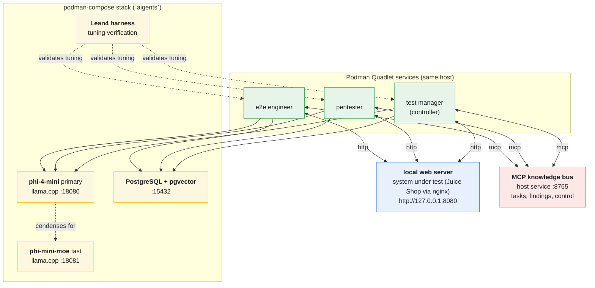

# open-testing-agents:selfhost

Video Presentataion can be found at https://codeberg.org/spifamily/open-testing-agents-abgabe
A presetation about this project is also in [./presentation](./presentation).

A self-hosted, fully declarative **testing lab** you can run on a single
machine: three AI agents — an **e2e engineer**, a **pentester** and a **test
manager** — test a real web application (**OWASP Juice Shop**), chain their
findings into one report, and stream the result to a terminal interface. No cloud,
no MQTT broker, no hand-edited state.

It is a small but complete example of an *agentic stack* built from tools you
control end to end:

- **Agents** — three [CrewAI](https://www.crewai.com/) crews, each a Podman
  **Quadlet** service, loading role skills (`playwright-testing`,
  `test-manager-report`) and writing Playwright tests against the SUT. All three
  carry the same MCP bus tool, so they exchange findings **peer-to-peer**; the
  test manager is the **controller**: it assigns each test case to the e2e
  tester and/or the pentester, **monitors** their state and dispatched tasks,
  dispatches follow-ups, and produces a final consolidated report.
- **Model** — two self-hosted llama.cpp endpoints: **phi-4-mini** on the GPU
  (`:18080`) is the agents' brain (128K context + native tool calling), shared
  by every crew, the CLI and the chat; **phi-mini-moe** (`:18081`) is a fast
  helper that condenses the shared findings before they enter the primary's
  context.
- **Memory** — **PostgreSQL + pgvector** for reports and embeddings.
- **Knowledge bus** — a small **MCP** server (`mcp-setup/`) over which the agents
  exchange findings and the manager dispatches test cases, start/stop commands.
- **SUT** — **OWASP Juice Shop** behind nginx as a rootless pod
  (`http://127.0.0.1:8080`); it is the *one* target every agent is scoped to.
- **Guardrails** — a **Lean4** harness formalises the agents' action boundaries
  *and* their single SUT; a crew only runs when both its tuning and its target
  are accepted.
- **Interface** — **terminal CLI** (`worker/tm_cli.py`) with real-time dashboard
  to interact with the test manager and watch e2e/pentester progress live.

Everything is provisioned with **OpenTofu** from the **nixpkgs** toolchain (no
NixOS required): `model-setup/` (podman-compose: database + both models),
`sut-setup/` (rootless SUT pod), `mcp-setup/` (the host MCP bus),
`agent-setup/` (agent Quadlets). The root `deploy/` module composes all four
services into one declarative configuration. `just deploy` / `just down` / `just status`
operate the whole stack — no imperative shell scripts in production.



Agents exchange knowledge over the **MCP bus** (`mcp-setup/`): the test manager
dispatches test cases (controller) and monitors the team, every role shares
findings, and these feed the next role's run (`worker/run_agent.py` pulls the
assigned case + prior findings from the bus, condenses them with the fast model
and stages a writable copy of its crew directory). All three crews carry the
same `custom:aigents_bus` tool, so the agents also read each other's findings
and the manager's direction directly (see *How the agents talk to each other*).
Findings also land in the `documents` table in Postgres, the live testing
process is published as markdown, and the final report is available via CLI.

For the Agent skills for Crewai Dhall is used to generate the files.
[Dhall](https://dhall-lang.org/) Has is safe by default due its total functional programming paradigm.
The Dhall source in `.dhall/` compiles to the crews the workers run. After
editing it, recompile before (re)starting so the deployed agents pick up new
personas, tools and tasks:

```sh
nix develop -c just              # compile .dhall -> build/<role>/ (+ build/agents/)
nix develop -c just deploy       # deploy the whole stack (root deploy/ module)
```

## Prerequisites & portability

The stack runs on any **systemd** Linux distro with **Nix** — NixOS is *not*
required. Anything the deploy needs that OpenTofu and its provisioners cannot
install lives in the flake; only a few host-level facts are beyond Nix:

The **container runtime is flexible**: `nix develop` prefers a host
`podman`/`podman-compose` when present and falls back to the Nix-provided ones
otherwise, so a bare host needs no podman package:

```sh
nix develop                       # prints whether it uses host or Nix podman
nix develop -c just start         # deploy the whole stack
```

Rootless podman needs a subuid/subgid range for your user (usually already set —
check `grep "^$USER:" /etc/subuid /etc/subgid`). To add one:

```sh
sudo usermod --add-subuids 100000-165535 --add-subgids 100000-165535 "$USER"
```

**Quadlet-generator caveat.** Podman converts `~/.config/containers/systemd/*.container`
into systemd units via a *user generator*, which systemd reads only from
`/run`,`/etc`,`/usr/local/lib`,`/usr/lib/systemd/user-generators` (there is no
user-writable path). If your distro ships podman this is already wired. On a host
**without** podman, register the Nix podman's generator once (needs root):

```sh
nix develop -c sh -c 'sudo install -Dm755 "$(dirname "$(dirname "$(command -v podman)")")/lib/systemd/user-generators/podman-user-generator" /usr/local/lib/systemd/user-generators/podman-user-generator"'
systemctl --user daemon-reload
```

> **Note:** the deploy never runs `podman` directly from a script — it is only
> invoked by OpenTofu provisioners (`podman build`/`run`, `podman-compose`) and by
> systemd for the Quadlet units. All of it is declarative state under `deploy/`.

## Security & hardening

The stack is loopback-only by default, and the deploy hardens both its state and
its containers:

- **State is encrypted at rest.** `deploy/terraform.tfstate` holds generated
  secrets (Postgres + Odysseus passwords, the model API key), so OpenTofu
  encrypts the state *and* plan files with PBKDF2 + AES-GCM
  (`deploy/encryption.tf`). The passphrase lives outside the repo in a `0600`
  file that the `just` recipes generate on first use:

  ```sh
  /var/spool/aigents/.tofu-state-passphrase   # override with AIGENTS_STATE_PASSPHRASE_FILE
  ```

  **Back that file up** — without it the state cannot be decrypted. Running raw
  `tofu -chdir=deploy …` (instead of `just`) means exporting it yourself; `tofu`
  otherwise **fails closed** rather than reading/writing plaintext:

  ```sh
  export TF_VAR_state_passphrase="$(cat /var/spool/aigents/.tofu-state-passphrase)"
  umask 077                       # keep the files tofu writes owner-only
  tofu -chdir=deploy plan
  ```

- **Generated secrets resist accidental teardown.** The `random_password`
  resources carry `prevent_destroy`, so a stray `tofu destroy` fails instead of
  silently rotating the Postgres/Odysseus credentials. (The `local_*` files are
  intentionally *not* guarded: the provider replaces them on every content
  change, so a guard there would block ordinary credential updates.)

- **The API refuses unsafe exposure.** `model_api_key` must be set whenever the
  model `bind_address` is not loopback, `expose_public` requires
  `bind_address = "0.0.0.0"`, the MCP bus host must stay on loopback, and Grafana
  requires a non-default admin password when enabled. Secret files are written
  `0600`, their directories `0700`.

- **Containers run hardened.** The agent units (which execute LLM-generated
  code) drop *all* Linux capabilities (`DropCapability=ALL`, re-adding only what
  a tool declares) and set `NoNewPrivileges=true`; the Odysseus services keep
  only the capabilities their entrypoints need, and the SUT units set
  `NoNewPrivileges=true`.

- **Nothing auto-starts or lingers.** `enable_on_boot` (default off) keeps the
  units out of `default.target`, and `enable_linger` (default off) makes
  `just stop` / `just shutdown` also run `loginctl disable-linger`, so no user
  services survive logout. Set both to `true` for an unattended server.

## Declarative Root Module (`deploy/`)

The `deploy/` directory is the single declarative controller for the entire
stack. It composes every service (model, SUT, MCP bus, agents, Odysseus) as
child modules with dependency waves falling out of OpenTofu's DAG.

The raw commands below need the state passphrase exported (see *Security &
hardening*); the `just` recipes do that for you.

```sh
# Deploy everything (model, sut, mcp, agents, odysseus)
tofu -chdir=deploy init
tofu -chdir=deploy apply -var run_interval=60 -var report_mail_to=test-manager@aigents.local

# Stop everything
tofu -chdir=deploy apply -var service_state=stopped

# Status
tofu -chdir=deploy output
```

> **Single state, single controller.** Drive the stack only through `deploy/`
> (or the `just` recipes). The `*-setup/` child modules are *libraries* sourced
> by `deploy/`; applying one directly (`tofu -chdir=agent-setup apply`) creates a
> second state that manages the same units and will drift from the root. If that
> has happened, stop everything through `deploy/`, confirm
> `tofu -chdir=deploy state list` covers every module, then remove the stale
> per-module `terraform.tfstate` files. The stack-lifecycle commands
> (`just start` / `just stop` / `just shutdown` / `just redeploy` / `just pace`)
> all go through the root module — there is no per-module script.

### Justfile Commands (Recommended)

```sh
just deploy           # full deploy (root module, service_state=running)
just down             # stop everything (service_state=stopped)
just status           # show outputs / service state
just pace 60          # set run_interval=60 and redeploy agents
just redeploy         # re-apply root module after code changes
```

Variables you can pass via `-var` or set in `deploy/terraform.tfvars`:
| Variable | Default | Description |
|----------|---------|-------------|
| `service_state` | `running` | `running` \| `stopped` |
| `run_interval` | `900` | seconds between agent runs |
| `report_mail_to` | `""` | mail recipient for test reports (via MCP bus) |
| `enable_on_boot` | `false` | enable systemd units for auto-start |

### Targeted module control (Advanced)

To converge just part of the stack, scope a **root** apply with `-target`
(never `-chdir` into a child module — that forks the state):

```sh
# only the agents (e.g. after editing a crew/persona)
tofu -chdir=deploy apply -var service_state=running -target=module.agents

# code round-trip: bus + agents + Odysseus, keep model + SUT up
tofu -chdir=deploy apply -var service_state=running \
  -target=module.mcp -target=module.agents -target=module.odysseus

# stop just the agents
tofu -chdir=deploy apply -var service_state=stopped -target=module.agents
```

Stopping keeps all state: podman images, GGUF weights, the Postgres data
directory and the agent volumes are untouched. Removing the configured units
entirely is a deliberate `tofu -chdir=deploy destroy`; the state is git-ignored,
so on a fresh checkout there is nothing to destroy until you deploy.

## Test manager CLI (controller console)

Drive the **test manager / controller** agent interactively from the terminal —
streamed answers against the self-hosted phi-4-mini model, slash commands that
dispatch test cases to the e2e tester and pentester over the **MCP bus**, and
transcripts saved to Postgres:

```sh
just tm                                  # or: nix develop -c python3 worker/tm_cli.py
./worker/tm_cli.py --once "/case both test the login for sqli and xss"
./worker/tm_cli.py --once "how far along is the security test?"

# Real-time status dashboard
./worker/tm_cli.py --watch               # live dashboard, 3s refresh
./worker/tm_cli.py --watch --interval 2  # 2s refresh
```

```
tm@aigents > /help                show this help
tm@aigents > /status              model + postgres + MCP bus connectivity
tm@aigents > /case <role> <tc>    assign a test case (role: e2e|pentester|both|all)
tm@aigents > /agents              agent service state (systemd user units)
tm@aigents > /start [role]        start the agent service(s) (default all)
tm@aigents > /stop [role]         stop the agent service(s) (default all)
tm@aigents > /tasks [role]        list assigned test-case tasks
tm@aigents > /findings [role]     read the findings the agents shared
tm@aigents > /process             show the live testing-process markdown
tm@aigents > /watch               real-time testing status dashboard (Ctrl+C to exit)
tm@aigents > /save                persist the current transcript to postgres
tm@aigents > /latest              print the most recent stored document
tm@aigents > /clear               reset the conversation (test-manager persona stays)
tm@aigents > /exit                quit (Ctrl+D / Ctrl+C works too)
```

The persona comes from the compiled `build/agents/test_manager_agent.json`
(`.dhall/test_manager_agent.dhall`), so the chat is `role`/`goal`/`backstory`
faithful. Live bus state (tasks, agent status) is injected into the model
context each turn. It honours `MODEL_URL`, `MODEL_NAME`, `MCP_URL` and
`POSTGRES_DSN` (the last falls back to `database/secrets/credentials.env`).
`/save` and `/latest` need `psycopg` on the client
(`pip install "psycopg[binary]"`); without it those two commands report that
Postgres is unavailable and everything else still works.

### Real-time Testing Status Dashboard

The `/watch` command (or `--watch` flag) launches a live terminal dashboard
that polls the MCP bus every few seconds and displays:

- **Agent services** — systemd status for e2e, pentester, manager (color-coded: green=active, red=inactive)
- **Test tasks** — table with all assigned tasks, color-coded by status (dim=pending, yellow=running, green=done, red=failed)
- **Recent findings** — latest findings shared on the bus by each role

```sh
# Interactive mode: press /watch inside the REPL
python3 worker/tm_cli.py
tm@aigents > /watch

# Or run dashboard directly (non-interactive)
./worker/tm_cli.py --watch               # 3s default interval
./worker/tm_cli.py --watch --interval 2  # custom refresh rate
```

Dashboard example output:
```
╔════════════════════════════════════════════════════════════════════╗
║  open-testing-agents  |  REAL-TIME STATUS DASHBOARD             ║
╠════════════════════════════════════════════════════════════════════╣
║  Last update: 08:20:47  MCP: http://127.0.0.1:8765/mcp          ║
╠════════════════════════════════════════════════════════════════════╣
║  AGENT SERVICES (systemd)                                         ║
    | role | unit | active | enabled |
    |------|------|--------|---------|
    | e2e  | agent-e2e.service   | active | generated |
    | pentester | agent-pentester.service | active | generated |
    | manager | agent-manager.service | active | generated |
╠════════════════════════════════════════════════════════════════════╣
║  TEST TASKS                                                       ║
    | 45 | e2e     | done     | test_login            | 04:22:26 | 04:23:07 |
    | 47 | pentester | pending  | test login sqli/xss  | 04:23:24 |          |
    | 11 | e2e     | running  | test login sqli/xss  | 20:39:48 |          |
╠════════════════════════════════════════════════════════════════════╣
║  RECENT FINDINGS (shared on bus)                                  ║
    ▸ ### pentester · findings · 06:02:04
      Security report for XSS and SQL Injection vulnerabilities...
    ▸ ### e2e · findings · 04:23:07
      crewai failed: Traceback...
╚═════════════════════════════════════════════════════════════════════╝
Press Ctrl+C to return to CLI
```

## How the agents talk to each other

All three crews carry the same `custom:aigents_bus` tool, so the e2e engineer,
the pentester and the test manager exchange knowledge **peer-to-peer over the
MCP bus** (`worker/mcp_server.py`) — not only through the worker:

- **test manager** — the controller and the user's interface: it assigns test
  cases (`action=assign`), starts/stops the agents and reads their state
  (`action=get_status`), inspects the task queue (`action=tasks`), reads the
  team's findings (`action=findings`), dispatches a follow-up pass when coverage
  is thin, and closes the loop by publishing the process (`action=publish`) and
  the final report.
- **e2e engineer / pentester** — read the manager's direction and each other's
  findings from the bus (`action=findings`), then share their own results
  (`action=note`, `action=submit`).

The worker still injects the live task + findings into every crew's inputs and,
for the manager, also the live **agent status and task list**, so monitoring
works even when the model does not call the tool itself.

Task accounting is honest: a run that crashes (`crewai failed: …`) or whose
Playwright test errors or times out closes its assigned task as status
`failed`, not `done` (`submit_findings` `success=false`) — the manager's
`tasks`/`get_status` views and the final report then reflect actual results
instead of pretending a broken run passed.

## Architecture

| Role            | Crew dir        | Work                              | Output            |
|-----------------|-----------------|-----------------------------------|-------------------|
| e2e engineer    | `build/e2e`     | playwright tests against the SUT  | `previous_output.md` (+ `playwright_test.py` via CLI) |
| pentester       | `build/pentester` | nmap/nikto/sqlmap security scans | `previous_output.md` |
| test manager    | `build/manager` | control + monitor the team, final report | `report.md` (process doc + findings + mail via bus) |

All three crews carry `custom:aigents_bus`, so the roles also read each other's
findings and the manager's direction directly off the bus (see *How the agents
talk to each other*). The pentester additionally carries `custom:run_command`, a
controlled exec tool (allow-listed binaries, no shell, SUT-scoped) that lets it
actually run its scanners and cite the real output.

### Tools are declarative too

Which CLI tools a role gets is data, not Dockerfile edits. `agent-setup/tools.tf`
holds one catalog entry per tool (`enabled`, `roles`, `apt`/`pip`/`go`/`binary`/
`run`/`env`, the `bins` it exposes for `run_command`, and optional
`capabilities`). OpenTofu renders each role's thin image layer on top of a shared
base — e2e gets Playwright, the pentester gets nmap/nikto/sqlmap/nuclei/whatweb/
ffuf/gobuster/hydra, the manager gets neither — and the `bins` become that role's
`run_command` allow-list. Add or remove a tool by editing the catalog (or passing
`tools_overrides`) and re-applying; nothing else changes.

Agents also load crewAI **skills** from `skills/` (progressive disclosure via
`SKILL.md`): `test-manager-report` for the manager, `playwright-testing` for the
e2e engineer.

Every cycle the worker asks the **Lean4 harness** to review the current tuning
parameters (`skills/lean/Main.lean` — queue_size, dedupe_cap, crew_timeout,
steps, step_cost) against that role's own `WellTuned` envelope. Only a verdict
of `accepted` lets the crew run.

## Formal Verification with Lean4

- **Harnessing:** agent action boundaries, tool pre-conditions and state
  transitions are formal types in `skills/lean/AgentHarness.lean`.
- **Tuning:** the safety envelope is role-aware — the e2e crew gets more,
  quicker steps, the pentester fewer, longer scan steps, the manager a
  moderate review budget. Proposed parameters are only applied when
  `AgentHarness.review` accepts them for that role, giving a mathematically
  guaranteed safety loop. (The Agda source in `skills/agda` is kept for
  traceability.)
- **CLI Integration:** Lean 4 verification runs as part of each agent cycle
  before the crew executes, enforced by the worker (`worker/run_agent.py`).

## Hardware & Model Specs

* **GPU:** NVIDIA RTX 3060 (12 GB). llama.cpp runs the CUDA image
  (`ghcr.io/ggml-org/llama.cpp:server-cuda`) with `model_gpu_layers = 99`, so
  every primary phi-4-mini layer is offloaded to VRAM. The GPU is passed to the
  containers as a CDI device (`nvidia.com/gpu=all`) from the
  **nvidia-container-toolkit**; set `model_gpu_layers = 0` for a pure-CPU run.
* **System RAM:** 16 GB.
* **Primary model (agents' brain):** `unsloth/Phi-4-mini-instruct-GGUF` —
  `Phi-4-mini-instruct-Q4_K_M.gguf` (~2.5 GB), alias `phi-4-mini`, one llama.cpp
  instance on `127.0.0.1:18080` shared by the crews, the CLI and the chat
  (context **65536** total = **16384 per slot**, **4** parallel slots, 3.8B
  dense, 128K native context, tool calling).
* **Fast model (supports the primary):** `smarttasks/Phi-mini-MoE-instruct-GGUF`
  — `Phi-mini-MoE-instruct-Q4_K_M.gguf` (~5 GB), alias `phi-mini-moe`, on
  `127.0.0.1:18081` (context **8192** = **4096** x 2 slots, 7.6B total / 2.4B
  active experts). Runs on CPU by default so it never competes for VRAM; the
  worker uses it to condense shared findings before they enter the primary's
  context.
* **Embeddings:** phi-4-mini hidden size **3072** -> `vector(3072)` in pgvector

## Reaching the stack from other devices (LAN)

Everything binds `127.0.0.1` by default. To connect from other devices in your
network, bind the services to `0.0.0.0` and open the firewall:

```hcl
# model-setup/ (owns the iptables rules for the whole stack)
bind_address   = "0.0.0.0"
model_api_key  = "change-me"        # required once you are not localhost-only
expose_public  = true
expose_ports   = [18080, 18081, 15432, 8080, 3001, 8765]
```

Also set `bind_address = "0.0.0.0"` in `sut-setup` and
`mcp_host = "0.0.0.0"` in `mcp-setup`. Only list a port in `expose_ports` when
its owning module actually binds `0.0.0.0`. `tofu -chdir=deploy output -json lan_matrix`
prints the full table.

| Service | Port | Owner module | Bind via |
|---------|------|--------------|----------|
| phi-4-mini OpenAI API | `18080` | model-setup | `bind_address` |
| phi-mini-moe OpenAI API | `18081` | model-setup | `bind_address` |
| PostgreSQL | `15432` | model-setup | `bind_address` |
| SUT nginx → Juice Shop | `8080` | sut-setup | `bind_address` |
| Juice Shop (direct) | `3000` | sut-setup | `bind_address` |
| Grafana | `3001` | sut-setup | `bind_address` |
| MCP bus (`/mcp`) | `8765` | mcp-setup | `mcp_host` |

> Expose the minimum: usually just `18080` (model) and `8080` (SUT) on a
> trusted network. Postgres and the model API should not leave localhost
> without `model_api_key` / a DB password.

## Step by step manuals for usage
- [docs/USER_MANUAL_TEST_CASES.md](./docs/USER_MANUAL_TEST_CASES.md)
